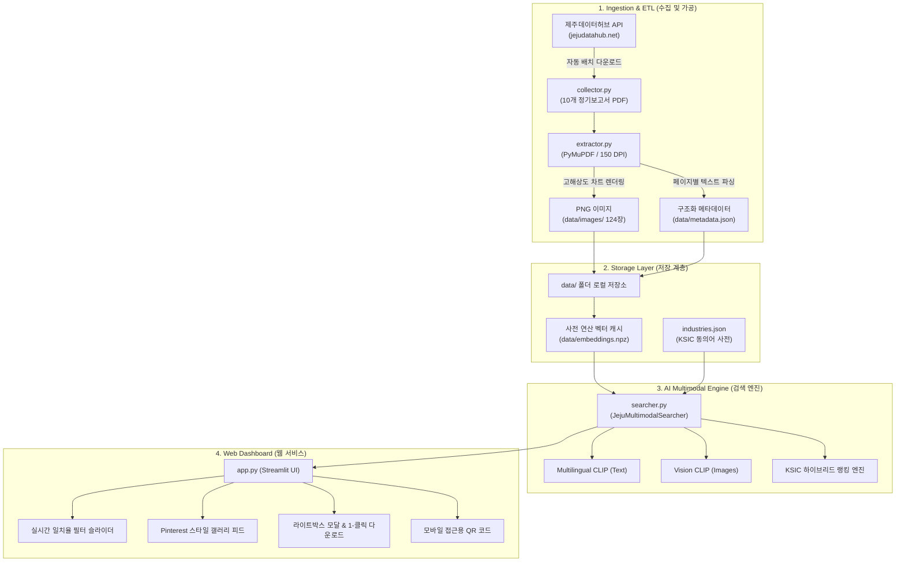

# 🌴 제주데이터허브 차트 & 이미지 AI 멀티모달 검색 시스템
> **Jeju Data Hub Multimodal AI (CLIP) Image & Chart Search System**  
> *Google DeepMind Antigravity 2.0 기반 개발 및 클라우드 배포*

[](https://samirwagle91-jeju-datahub.streamlit.app)
[](https://www.python.org/downloads/)
[](https://opensource.org/licenses/MIT)

---

## 📌 1. 프로젝트 배경 및 목표 (Background & Objectives)

### 🔴 AS-IS (기존 문제점)
- 제주데이터허브([https://jejudatahub.net](https://jejudatahub.net))는 제주도 빅데이터와 정기 분석 보고서를 풍부하게 제공하지만, 사용자가 원하는 특정 소비 트렌드 그래프나 통계 차트를 찾으려면 **수십 페이지 분량의 개별 PDF 보고서를 일일이 다운로드받아 수작업으로 열람**해야 했습니다.
- 일상적인 일상어 검색어(예: *"렌터카"*, *"외식"*, *"호텔"*)를 사용하면 행정 공식 분류명(예: *"자동차 임대업"*, *"한식음식점업"*, *"휴양콘도운영업"*)과 불일치하여 검색 효율이 현저히 저하되었습니다.

### 🟢 TO-BE (구축 시스템)
- **Google DeepMind Antigravity 2.0**을 활용하여 텍스트 질의(한국어 일상어)와 차트 이미지를 하나의 공통 512차원 잠재 벡터 공간에 정렬하는 **AI 멀티모달(Multilingual CLIP) 검색 시스템**을 구축하였습니다.
- 한국표준산업분류(KSIC) 동의어 확장 엔진과 결합하여, 사용자가 키워드를 입력하는 즉시 **최적의 소비 트렌드 차트 이미지를 일치율(%), 일치 이유, 본문 문맥 하이라이트**와 함께 갤러리 피드 형태로 검색·열람할 수 있는 웹 서비스를 구현하였습니다.
- Streamlit Community Cloud를 통해 전 세계 누구나 웹 브라우저 및 모바일 기기(QR 코드)로 즉시 접근할 수 있도록 공개 배포하였습니다.

---

## 🏛️ 2. 시스템 아키텍처 (System Architecture)



---

## 🌟 3. 핵심 기능 (Key Features)

1. **Multilingual CLIP 기반 시각-언어 멀티모달 검색**:
   - `sentence-transformers/clip-ViT-B-32-multilingual-v1`을 적용하여 한국어 자연어 텍스트와 이미지 간의 교차 모달(Cross-modal) 의미론적 코사인 유사도를 실시간 계산합니다.
2. **KSIC(한국표준산업분류) 도메인 동의어 확장**:
   - 사용자가 *"렌터카"*, *"외식"*, *"골프장"*, *"주유소"* 등 일상어를 입력하면 행정 표준 분류어(*"자동차 임대업"*, *"차량용가스충전업"*, *"한식음식점업"* 등)로 자동 확장되어 누락 없는 고정밀 검색을 보장합니다.
3. **직관적인 검색 일치율(%) 및 일치 이유 설명 (XAI)**:
   - 검색된 모든 차트 카드에 정확한 일치율 배지(예: `일치율 95%`)와 함께 매칭된 사유(예: *"한국표준산업분류(KSIC) 연계 매칭 및 본문 문맥 일치"*, *"멀티모달 시각-텍스트 의미 유사도 일치"*)를 투명하게 제공합니다.
4. **실시간 일치율 필터 슬라이더**:
   - 0% ~ 100% 범위의 슬라이더를 통해 사용자가 원하는 신뢰도 수준의 이미지만 실시간 필터링하여 탐색할 수 있습니다.
5. **고해상도 라이트박스 모달 & 원클릭 다운로드**:
   - 차트 썸네일 클릭 시 고해상도 확대 모달 창이 열리며, 원본 PNG 차트 이미지 및 원본 PDF 보고서를 1클릭으로 다운로드할 수 있습니다.
6. **반응형 갤러리 및 모바일 QR 코드 연동**:
   - 데스크톱 및 모바일 브라우저를 모두 지원하며, 사이드바의 QR 코드를 통해 스마트폰으로도 간편하게 접속할 수 있습니다.

---

## 📂 4. 프로젝트 구조 (Directory Structure)

```
KH/
├── .devcontainer/              # VS Code 개발 컨테이너 환경 설정
│   └── devcontainer.json
├── data/                       # 데이터 계층
│   ├── images/                 # 150 DPI 고해상도 차트 PNG 이미지 (124장)
│   ├── reports/                # 제주데이터허브 정기 보고서 원본 PDF (10건)
│   ├── metadata.json           # 전체 페이지 텍스트 및 메타데이터
│   ├── reports_metadata.json   # 수집된 보고서 정보
│   └── embeddings.npz          # 512차원 사전 연산 멀티모달 임베딩 벡터 캐시
├── app.py                      # Streamlit 웹 대시보드 메인 애플리케이션
├── collector.py                # 제주데이터허브 API 정기 보고서 자동 수집기
├── extractor.py                # PyMuPDF 기반 텍스트 추출 및 150 DPI 이미지 렌더러
├── searcher.py                 # Multilingual CLIP + KSIC 동의어 하이브리드 검색 엔진
├── run_pipeline.py             # 수집-추출-인덱싱 전체 파이프라인 자동 실행 스크립트
├── industries.json             # 한국표준산업분류(KSIC) 8개 핵심 업종 동의어 사전
├── counts.txt                  # 데이터 색인 및 시스템 요약 리포트
├── sample_p7.txt               # 주요 소비 비교 차트 추출 텍스트 샘플
├── requirements.txt            # 클라우드 배포용 의존성 패키지 목록
└── README.md                   # 프로젝트 전체 안내서
```

---

## 🚀 5. 로컬 실행 방법 (Local Quickstart)

### 1) 저장소 클론 및 패키지 설치
```bash
git clone https://github.com/Samirwagle91/jeju-datahub-web.git
cd jeju-datahub-web
pip install -r requirements.txt
```

### 2) 데이터 파이프라인 실행 (수집, 추출, 임베딩 인덱싱)
```bash
python run_pipeline.py
```
> *이미 `data/` 폴더에 10개 보고서의 124장 고해상도 이미지와 사전 연산된 `embeddings.npz`가 포함되어 있으므로 이 단계를 건너뛰고 바로 앱을 실행하셔도 됩니다.*

### 3) Streamlit 웹 애플리케이션 실행
```bash
streamlit run app.py
```
웹 브라우저에서 `http://localhost:8501`로 접속합니다.

---

## ☁️ 6. Streamlit Community Cloud 무료 배포 가이드

1. **GitHub 공개 저장소(Public Repository) 생성**:
   - `jeju-datahub-web`이라는 이름으로 GitHub에 Public 리포지토리를 생성합니다.
   - 본 프로젝트의 코드를 커밋 및 푸시합니다:
     ```bash
     git add .
     git commit -m "Update URLs and deployment configurations for Samirwagle91"
     git branch -M main
     git remote add origin https://github.com/Samirwagle91/jeju-datahub-web.git
     git push -u origin main
     ```
2. **Streamlit Community Cloud 배포 ([share.streamlit.io](https://share.streamlit.io))**:
   - [share.streamlit.io](https://share.streamlit.io)에 접속하여 GitHub 계정으로 로그인합니다.
   - **New app** 버튼을 클릭합니다.
   - Repository: `Samirwagle91/jeju-datahub-web` 선택
   - Branch: `main`
   - Main file path: `app.py`
   - App URL: `https://samirwagle91-jeju-datahub.streamlit.app` (또는 원하는 이름)
   - **Deploy!** 버튼을 클릭하면 수 분 내에 공개 HTTPS URL이 생성됩니다.
3. **QR 코드 갱신**:
   - 생성된 공개 URL(예: `https://your-app.streamlit.app`)을 사이드바의 URL 입력란에 입력하면 모바일 접속용 QR 코드가 자동으로 갱신됩니다.

---

## 📊 7. 파이프라인 통계 요약 (counts.txt)

- **수집 보고서**: 총 10건 (제주특별자치도 AI데이터팀 BC카드 정기 소비동향 분석)
- **렌더링 차트 이미지**: 총 124장 (150 DPI 고해상도 PNG)
- **멀티모달 임베딩**: 512차원 정규화 벡터 (이미지 124개, 텍스트 124개)
- **KSIC 동의어 카테고리**: 8개 핵심 산업군 (렌터카, 외식, 골프장, 숙박, 카페, 면세점, 주유소, 교통)

---

## 📜 8. 라이선스 (License)
본 프로젝트는 MIT 라이선스에 따라 자유롭게 사용 및 수정이 가능합니다.
